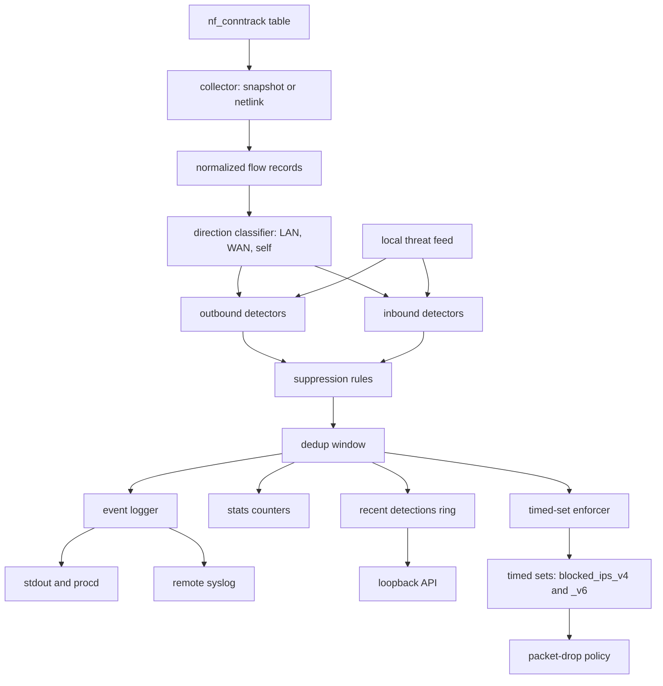
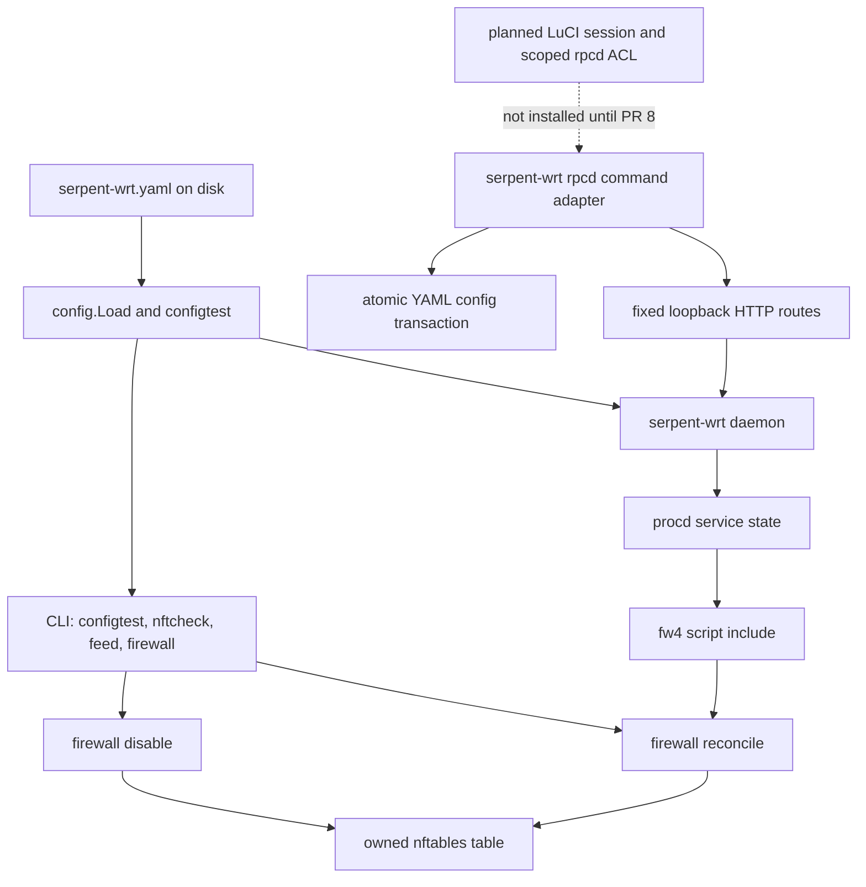

# Architecture

`serpent-wrt` is built for constrained OpenWrt routers. It favors bounded
metadata analysis over packet capture, payload inspection, or persistent
storage.

## Why Conntrack

Linux keeps connection metadata in `nf_conntrack`. The default collector
reads that table once per poll cycle. Optional netlink mode consumes only
connection-create events through the available `conntrack` CLI.

| Capability | Packet capture | Conntrack metadata |
| --- | --- | --- |
| CPU cost | Per packet | Per poll cycle or new connection event |
| Memory profile | Capture buffers and optional reassembly | Existing kernel flow table |
| Data collected | Payload and headers | Protocol, IPs, ports, state, time |
| Storage pressure | Often paired with PCAP files | None by default |
| Router fit | Heavy on small targets | Lightweight and bounded |
| Enforcement path | Separate integration | Reuses nftables |

## Detection Data Flow

The detector, suppression, dedup, and retention stages keep bounded state.
The feed stage is a local file. Nothing in this path fetches remote data.

## Management And Enforcement Flow

The rpcd command adapter has fixed methods and no arbitrary command or file arguments.
Its wrapper and ACL files are staged for the future LuCI package.
That package and its browser views are not installed by the daemon package.
Operators can still use the YAML file and service commands.

Timed sets and packet drops are separate outcomes.
The enforcer writes set elements under timeouts.
The managed drop policy owns one forward chain that reads those sets.
An external ruleset flush can remove resources, and the daemon reports their loss.

## Module Contracts

| Module | Inputs | Outputs | Visible failure behavior |
| --- | --- | --- | --- |
| Collector, snapshot | `/proc/net/nf_conntrack` | Normalized flow records per new tuple | More than 16,384 records sets `snapshot_overflow`; detection pauses until a complete baseline |
| Collector, netlink | `conntrack -E -e NEW` | New-flow events | Missing tool, permission, or stream end records `fallback_error` and falls back to snapshots |
| Feed loader | Local feed file | Exact-address and CIDR sets | Invalid entry or unreadable file fails the load and keeps the previous entries |
| Direction classifier | Flow tuple, `lan_cidrs`, `self_ips` | LAN, WAN, or self | Router-originated flows are excluded from detection |
| Detectors | Classified flows, profile thresholds | Detection events with reasons | A full state limit stops new distinct values for that tracker |
| Suppression | Detection, rule list | Kept or dropped detection | A dropped detection is counted and not emitted |
| Dedup | Kept detection | At most one event per window key | Duplicate signals are suppressed and counted |
| Event logger | Detection | stdout line, optional syslog event | An unavailable syslog target does not stop stdout logging |
| Recent ring | Detection | Last 100 records for the API | Older records are overwritten |
| Loopback API | HTTP on the configured loopback bind | Status, stats, detections, feed operations | A non-loopback bind warns; a disabled API returns no data |
| Timed-set enforcer | Detection source, block duration | Set element with timeout | Missing `nft` or sets marks nft setup failed and records the error |
| Packet-drop policy | Configuration, fw4 include, nft state | One owned forward chain | Missing fw4, offloading, shared table, or foreign chain refuses activation and leaves prior rules |
| Firewall disable | Persisted identity file | Removed owned chain | Fails closed on unreadable or reserved identity and keeps the chain |
| Service control | procd and configuration | Started or stopped instance | Invalid configuration fails before a restart stops the running daemon |

## Collection Semantics

Snapshot mode is the default. The first snapshot is a baseline.
Later snapshots process each tuple only when it first appears.
A tuple that stays in the table creates no new activity.
A tuple that leaves and later returns counts as new.

The parser stops after 16,385 valid conntrack records. The extra record signals overflow.
The runtime clears its comparison history and pauses new-flow detection.
It resumes only after a complete snapshot with no more than 16,384 records.
That snapshot becomes the new baseline.
The poll interval sets cadence resolution.

`collector: netlink` runs `conntrack -E -e NEW` and records each new event once.
It uses event receipt time for cadence analysis.
The `conntrack` CLI is optional, not a required daemon dependency.
If it is missing, lacks permission, or its event stream ends, serpent-wrt logs the reason and falls back to snapshots.
Snapshot mode then establishes a fresh baseline before it processes new tuples.
`/status` reports the configured and active collector plus any fallback error.

Beacon history stores at most 512 source/destination pairs, 64 timestamps per pair, and 8,192 timestamps total.
When a history limit is full, the collector drops new samples until expiry frees space.
Do not interpret these limits as a total process-memory budget.

## NAT Tuple Semantics

Conntrack snapshots retain the original tuple and the reply tuple.
The original destination stays in `dst_ip` and `dst_port`.
When the reply source differs, `translated_dst_ip` and `translated_dst_port` report the translated destination.
Direction classification uses the translated destination when present.
The `conntrack -E -e NEW` event can lack reply tuple data, so it cannot establish DNAT translation alone.

## Scan Alert Semantics

`port_scan` and `ext_scan` emit one alert when the count in the time window first reaches its threshold.
The alert includes `distinct_port_count` and the sorted `observed_dst_ports` at the threshold.
Expiry rearms the episode when the distinct-port count drops below the threshold.
A later threshold event starts a new alert episode.

Each distinct-value tracker stores at most 1,024 keys, 256 values per key, and 4,096 values total.
When a value limit is full, the tracker rejects new distinct values and preserves values it already stores.
The detector can therefore miss activity after a state limit.
Configuration rejects thresholds above the per-key value limit.

## Enforcement Boundary

When `enforcement_enabled` is true, the daemon validates its nft batch with `nft --check` before it applies the batch.
It creates one `ipv4_addr` set and one `ipv6_addr` set in the configured inet table.
The configured set name is the base name. The daemon adds `_v4` or `_v6` to each set name.

`serpent-wrt nftcheck` parses the set definitions even when enforcement is disabled.
It does not apply a ruleset or prove packet drops.

`packet_drop_enabled` adds an explicit, optional policy in development builds.
It defaults to false and requires timed-set enforcement.
The selected offender remains the detection source address.
An outbound feed match can therefore isolate the originating LAN host.

The owned `serpent_forward` chain uses the configured dedicated `inet` table.
It has a forward hook, priority `-1`, and an accept policy.
Its two rules match IPv4/IPv6 source addresses in their respective timed sets, then count and drop packets.
It adds no input or output hooks.

The package registers one fw4 script include at `firewall.serpent_wrt`.
The script reconciles only when procd reports the daemon active.
Reconciliation preserves timed elements and their remaining timeouts.
It refuses offloading, unavailable prerequisites, shared tables, and foreign chain ownership.
One private lock serializes firewall mutations.
The private identity lets disable remove only the owned chain after an invalid YAML edit.

`/blocked` and `blocks_applied` describe set management, not packet drops.
Packet-drop readiness requires the active hook and both rule references.
After kernel resource loss, the daemon clears stale cached blocks and reports resource recreation.
It cannot recover lost kernel elements.
Local kernel checks do not replace the authorized OpenWrt packet-path gate.

## Detectors

| Detector | Direction | Security outcome |
| --- | --- | --- |
| `feed_match` | LAN to WAN | Internal host contacts a listed IP/CIDR. |
| `feed_match` | WAN to LAN | Known-bad external source reaches an internal host. |
| `beacon` | LAN to WAN | Host contacts the same destination on a regular cadence. |
| `fanout` | LAN to WAN | Host reaches too many distinct external destinations. |
| `port_scan` | LAN to WAN | Internal host probes many ports on one external target. |
| `ext_scan` | WAN to LAN | External source probes many ports on one internal host. |
| `brute_force` | WAN to LAN | External source hits the same service port across many internal hosts. |

Detection events include original and translated destination fields for DNAT snapshots.
Scan events include the threshold count and sorted distinct ports when the detector reaches its threshold.

## Invariants

- Bounded in-memory state.
- Detect-only by default.
- No packet capture or payload inspection.
- No persistent database.
- IPv4 and IPv6 flow metadata are supported.
- Snapshot mode is the default collector and fallback when netlink is unavailable.
